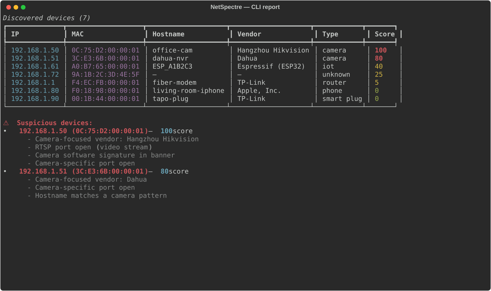
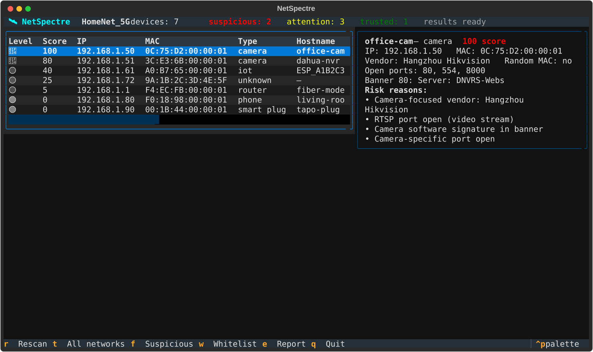

<h1 align="center">NetSpectre</h1>

<p align="center">Find hidden cameras and unknown IoT devices on your Wi-Fi network.</p>

## Screenshots

<p align="center">
  
</p>

<p align="center">
  
</p>

## Features

- Discovers devices with ARP, mDNS and SSDP on the local network
- Identifies cameras, NVRs and IoT devices from OUI, ports, banners and hostnames
- Gives every device a 0-100 risk score with plain-language reasons
- Listens without sending packets in passive mode
- Interactive TUI with live scanning, a sortable table, filtering and a detail panel
- Exports JSON or Markdown reports, with optional IP/MAC anonymization
- Flags devices that were not present in the previous scan
- Whitelists known devices by MAC; runs on Linux with Python 3.10-3.13

## Installation

Build and run from source:

```bash
git clone https://github.com/colgecen/NetSpectre.git
cd NetSpectre
./netspectre --install
```

`--install` is a one-time step that lets you type `netspectre` (no `./`) to open the build menu:

```bash
netspectre
```

Prebuilt binaries are available on the [Releases](https://github.com/colgecen/NetSpectre/releases) page.

## Usage

Run the app straight from source (press `Ctrl+C` to stop):

```bash
./netspectre
```

The TUI opens and scans the saved networks; press `r` to rescan, `t` for all networks, `f` to show only suspicious devices, `w` to whitelist the selected device, `e` to export a report and `q` to quit. Configuration is read from `config.yaml` in the current directory; copy `config.example.yaml` to change ports, scan modes or the whitelist.

## License

This project is licensed under the [MIT](LICENSE) license.
