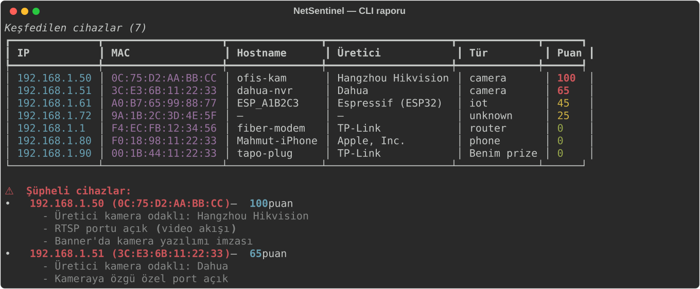
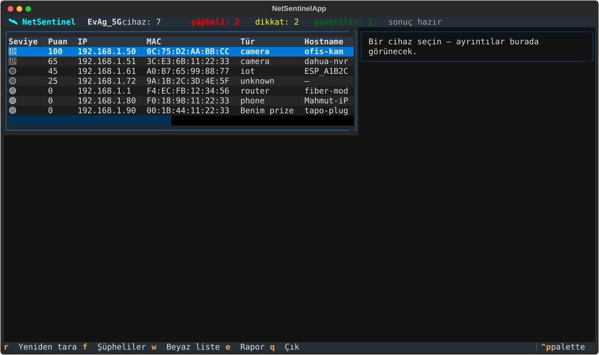

# NetSentinel

> Ev ağındaki görünmez kameraları ve bilinmeyen IoT cihazlarını bul.

Ağında hangi cihazların yaşadığını bilir misin? Misafirlerin bağlandığı oturma odası
hoparlörü kimin? Kullandığın ağ kamerası gerçekten sadece sana mı bakıyor?

**NetSentinel** kendi Wi-Fi ağında cihaz keşfi yapar, imza eşleştirmeyle **kameraları,
kayıt cihazlarını (NVR) ve şüpheli IoT cihazlarını** ortaya çıkarır ve her cihaza risk
puanı verir. Agresif port taraması yerine **cihaz kimliği tespitine** odaklanır: ARP,
mDNS/SSDP duyuruları, hafif port tespiti ve imza/banner eşleştirmeyle çalışır.

[](https://github.com/colgecen/NetSpectre/actions/workflows/ci.yml)


## Ekran görüntüleri

CLI raporu — cihazlar risk puanına göre renkli tabloda, şüpheliler gerekçeleriyle:



Etkileşimli terminal arayüzü (`--tui`) — canlı tarama, sıralanabilir tablo, detay paneli:



## Özellikler

- **Cihaz keşfi**: Scapy ile ARP taraması + zeroconf ile mDNS servis duyuruları + SSDP
  (`M-SEARCH` ve pasif `NOTIFY`) — ağdaki cihazları isim, üretici ve servisleriyle bulur
- **Kamera ve IoT imzaları**: `src/netsentinel/data/camera_signatures.yaml` port/banner/servis
  kalıplarıyla
  kamera, NVR ve mikraf sınıfı cihazları tanır; `--passive` modda ağa hiçbir paket
  göndermeden yalnızca mDNS/SSDP dinler
- **Üretici/tür önerisi**: imza eşleşmezse 40 bin kayıtlık yerel IEEE OUI veritabanından
  (`src/netsentinel/data/oui.json`) üretici ve cihaz türü önerir
- **Risk puanı**: her cihaz 0-100 puan ve `düşük/orta/yüksek/kritik` seviyesi alır;
  gerekçeler (açık RTSP portu, kamera banner'ı, kimliksiz cihaz, rastgele MAC…) tek tek
  yazılır
- **Hafif port tespiti**: nmap ile yalnızca yapılandırmandaki `scan.ports` taranır,
  `--rate` ile hız sınırlanır; nmap kurulu değilse sessizce devre dışı kalır
- **Beyaz liste**: kendi cihazların (`config.yaml` → `whitelist`) uyarılara girmez
- **Yeni cihaz uyarısı**: son JSON raporuyla karşılaştırır, ağa yeni katılanları
  `YENİ` diye işaretler
- **Raporlama**: `--export json|md` ile rapor dizinine zaman damgalı dosya,
  `--anonymize` ile IP/MAC maskelenmiş paylaşım sürümü
- **Etkileşimli TUI**: `--tui` ile Textual arayüzü — canlı tarama akışı, tıklayıp
  sıralanabilir tablo, üretime göre filtre, canlı detay paneli
- **Yerel kalır**: hiçbir telemetri/bulut yok; yapılandırmada Wi-Fi şifresi tutulmaz
  (NetworkManager profilleri kullanılır), raporlarda varsayılan olarak kimlik bilgisi
  yazılmaz

## Hızlı başlangıç

```bash
git clone https://github.com/colgecen/NetSpectre.git
cd NetSpectre
python3 -m venv .venv && source .venv/bin/activate
pip install .
netsentinel --no-connect            # bağlı olduğun ağda hızlı tarama
```

`config.yaml` zorunlu değildir; araç yerleşik güvenli varsayılanlarla çalışır. Ağ seçimi
veya beyaz liste için şablondan kopyala: `cp config.example.yaml config.yaml`.

Etkin mod (ARP taraması) ham paket göndermek ister. Python'a yetenek ver veya sudo ile
çalıştır:

```bash
sudo setcap cap_net_raw,cap_net_admin+eip "$(readlink -f "$(command -v python3)")"
# ya da: sudo .venv/bin/python -m netsentinel --no-connect
```

Yetki yoksa NetSentinel komutu çalıştırmaz, yukarıdaki komutu önerir. `--passive` mod
yetki gerektirmez.

## Kullanım

```bash
# Bağlı ağda tam tarama (keşif + imza + port + puanlama)
netsentinel --no-connect

# Ağ seç: kayıtlı NetworkManager profiliyle bağlan (şifre config'de tutulmaz)
cp config.example.yaml config.yaml && chmod 600 config.yaml
netsentinel --config config.yaml

# Pasif dinleme: hiç paket gönderme, yalnızca mDNS/SSDP duyurularını topla
netsentinel --passive --no-connect

# TÜM ağlar: görünen her Wi-Fi'yi listeler; kayıtlı NetworkManager profili
# olanlara tek tek bağlanıp tarar. Profili olmayanlar "atlanan" olarak
# gerekçesiyle yazdırılır (şifre denemesi yapılmaz — sadece kayıtlı profiller).
netsentinel --all-networks

# JSON/Markdown raporu dosyaya yaz, IP/MAC'leri maskele
netsentinel --no-connect --export json --anonymize

# Port tarama hızını sınırla (paket/sn)
netsentinel --no-connect --rate 20

# Etkileşimli Textual arayüzü; 't' tuşu açılışta da, sonrasında da
# tüm kayıtlı ağları dolaşabilir
netsentinel --tui
```

TUI kısayolları: `r` yeni tarama · `t` TÜM ağları dolaş · `f` filtre (sadece şüpheliler)
· `w` beyaz listeye al · `e` rapora disa aktar · basliktaki `enter` ile sirala · `q` çıkış.
```

## Nasıl çalışır?

1. **Bağlantı**: `nmcli` ile hedef SSID'e bağlanır (veya `--no-connect` ile mevcut
   bağlantı kullanılır); arayüz, ağ geçidi ve alt-ağ tespit edilir
2. **Keşif**: ARP broadcast'i (Scapy), mDNS servis gezinme (zeroconf) ve SSDP sorguları
   paralel çalışır; sonuçlar IP/MAC üzerinden birleştirilir
3. **Port tespiti**: nmap varsa yalnızca `scan.ports` listesi, `scan.rate_limit` hızıyla
   taranır; servis banner'ları toplanır
4. **Sınıflandırma**: `src/netsentinel/data/camera_signatures.yaml` imzaları → üretici OUI'si → hostname
   kalıpları sırasıyla denenir; beyaz liste düşülür
5. **Puanlama**: her bulgu risk puanına gerekçesiyle yazılır; eşik üzerindeki cihazlar
   "şüpheli" olarak işaretlenir

| Bağımlılık | Ne için | Zorunlu mu? |
| --- | --- | --- |
| `scapy` | ARP keşfi (ham paket) | evet (yetki ister) |
| `zeroconf` | mDNS dinleme | evet |
| `textual` | `--tui` arayüzü | evet |
| `pyyaml` | config + imza dosyaları | evet |
| `rich` | tablo/renk çıktıları | evet |
| `nmap` | port tespiti | opsiyonel |
| `nmcli` | Wi-Fi bağlantısı | opsiyonel (`--no-connect` varsa) |

## Geliştirme

```bash
git clone https://github.com/colgecen/NetSpectre.git
cd NetSpectre
python3 -m venv .venv && source .venv/bin/activate
pip install -e ".[dev]"
pytest                                  # 207 test
ruff check . && ruff format --check .   # lint
mypy                                    # tip kontrolü
```

GitHub Actions CI hattı bunları Python 3.10-3.13 matrisinde çalıştırır; ayrıca
`pip-audit` ile bağımlılık güvenlik denetimi yapar.

Yardımcı betikler:

- `scripts/update_oui.py` — IEEE OUI veritabanını `src/netsentinel/data/oui.json`a indirir
- `scripts/distro_test.sh` — container içinde tam kurulum + test koşar
- `scripts/make_screenshots.py` — README ekran görüntülerini (SVG) üretir

### Paket olarak dağıt: AppImage

Har makineye tek dosya taşımak istersen repo kökündeki `netspectre` betiği PyInstaller
ile kendi- kendine yeten Linux paketi üretir (imza/OUI verileri pakete gömülüdür):

```bash
./netspectre linux appimage   # build/NetSpectre.AppImage (~41 MB, tüm dağıtımlar)
./netspectre linux targz      # build/netspectre_Linux_x86_64.tar.gz
./netspectre --install        # iki komutu kurar: netspectre (menu) + net-spectre (uygulama)
./netspectre --yetki          # derlenen ikiliye ARP yetkisi ver (sudo şifre sorar)
```

Kurulduktan sonra herhangi bir dizinden:

```bash
netspectre                    # paketleme menüsü
net-spectre                    # TUI; içinde 't' = tüm kayıtlı ağları dolaş
net-spectre --hepsi            # açılışta tüm ağlar modu; yetki yoksa sudo önerir
```

`--install` ise PATH'te iki komut kurar — adları birbirine karışmasın:

| Komut | Ne yapar |
|---|---|
| `netspectre` | Paketleme menüsü (derle/dağıt — bu betik) |
| `net-spectre` | Uygulama; argümansız çalışınca terminal arayüzü (TUI) açılır |

AppImage'ı çalıştırmadan önce `chmod +x NetSpectre.AppImage` yeterlidir. Etkin mod
(ARP) ham paket yetkisi istediğinden AppImage içinde `sudo …` ile çalıştırılır veya
`--passive` kullanılır; arayüz yetki yoksa **kendiliğinden pasif moda düşer**.
Windows/macOS paketleme güvenilir çapraz derleme olanağı olmadığı için desteklenmez.

### Uyumluluk

Kurulum + tam test paketi container'da doğrulanmıştır (`scripts/distro_test.sh`):

| Dağıtım | Sonuç |
| --- | --- |
| Ubuntu 24.04 | ✅ 207/207 test |
| Debian 13 (trixie) | ✅ 207/207 test |
| Arch Linux | ✅ 207/207 test |
| Kali Rolling | ✅ 207/207 test |

- **Python**: 3.10, 3.11, 3.12, 3.13
- **İşletim sistemi**: Linux (ham paket + Scapy nedeniyle Windows/macOS desteklenmiyor)
- **Yetkiler**: ARP taraması `cap_net_raw`/`cap_net_admin` ister; `--passive` ve TUI
  yetkisiz çalışır

## Mimari

```text
┌──────────────┐   ┌──────────────────────────┐   ┌──────────────────┐
│    CLI /     │──▶│      discovery/scan      │──▶│    analyzer/     │
│    TUI       │   │  arp + mdns + ssdp birleşik│ │  fingerprint/oui │
└──────────────┘   └──────────────────────────┘   │  ports/scoring   │
       ▲                                          └────────┬─────────┘
       │              ┌────────────────┐                   │
       └──────────────│   report.py    │◀──────────────────┘
                      │ JSON/MD + diff │
                      └────────────────┘
```

Modüller:

- `src/netsentinel/__main__.py`: CLI arayüzü, tablo/uyarı çıktısı, rapor bağlantısı
- `src/netsentinel/wifi_manager.py`: nmcli sarıcısı — tarama, profil ile bağlanma
- `src/netsentinel/permissions.py`: yetenek (capability) denetimi ve setcap önerisi
- `src/netsentinel/discovery/`: `arp.py` (Scapy), `mdns.py` (zeroconf), `ssdp.py`,
  `scan.py` (orkestrasyon + birleştirme)
- `src/netsentinel/analyzer/`: `fingerprint.py` (imza motoru), `oui.py` (üretici),
  `ports.py` (nmap sarmalayıcı), `scoring.py` (risk puanı)
- `src/netsentinel/report.py`: JSON/Markdown rapor, anonimleştirme, yeni cihaz farkı
- `src/netsentinel/ui/`: Textual uygulaması (`app.py`) ve widget'lar
- `src/netsentinel/models.py`: `Device` / `NetworkInfo` / `ScanResult` veri modelleri

## Katkıda bulunma

Önce `pytest && ruff check . && mypy` çalıştır; commit mesajlarında gelenekselsel
konvansiyonel başlık (`feat:`, `fix:`, `docs:`) kullan. Yeni imza eklerken
`data/camera_signatures.yaml` şemasını ve test kalıbını örnek al.

## Ticari kullanım

NetSentinel'in ticari sürümü [Repolar](https://repolar.com) çatısı altında satılmaktadır.
Bu açık kaynak sürüm bireysel kullanıma yöneliktir. Detaylar:
[repolar.com/tr/lisanslar](https://repolar.com/tr/lisanslar)

## Lisans

Kişisel kullanım ve değiştirmeden dağıtıma izin veren kaynak açık lisans. Detaylar için
[LICENSE](LICENSE) dosyasına bak.

## Yasal uyarı

Bu araç yalnızca kendi sahibi veya yazılı kullanım yetkisi olan kişi/kurumların ağını
incelemek için verilmiştir. Başkalarının ağını taramak yasadışıdır; geliştirici yanlış
kullanımdan doğan sorumluluğu kabul etmez. Çok ağlı mod yalnızca NetworkManager'da
**hâlihazırda kayıtlı** profilleri kullanır; şifre kırma veya ağlar arası şifre denemesi
yapılmaz.

---

Repolar altında geliştirilmektedir.
